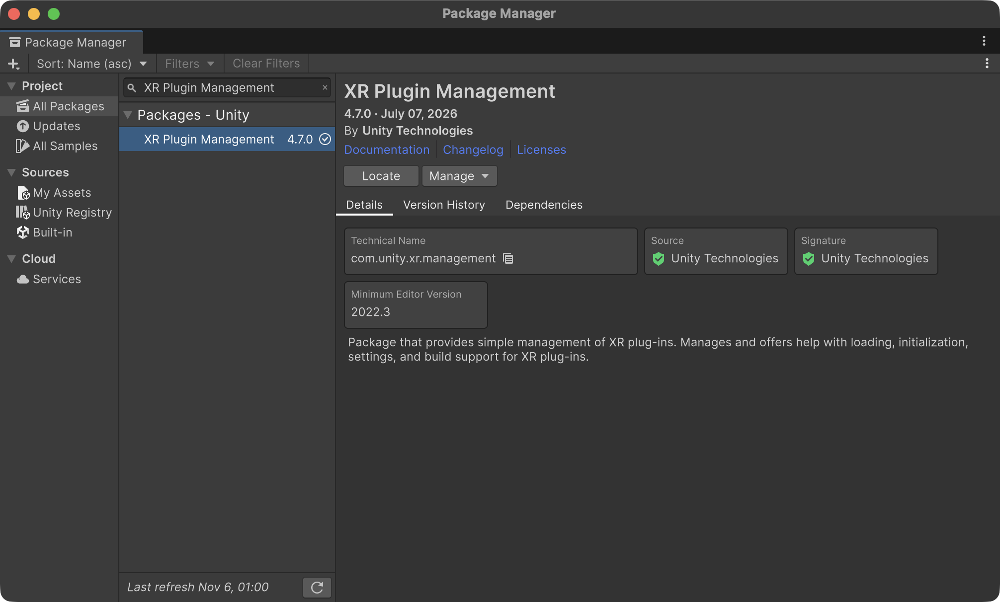
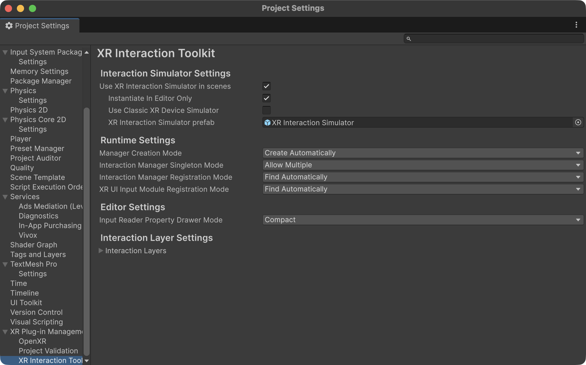
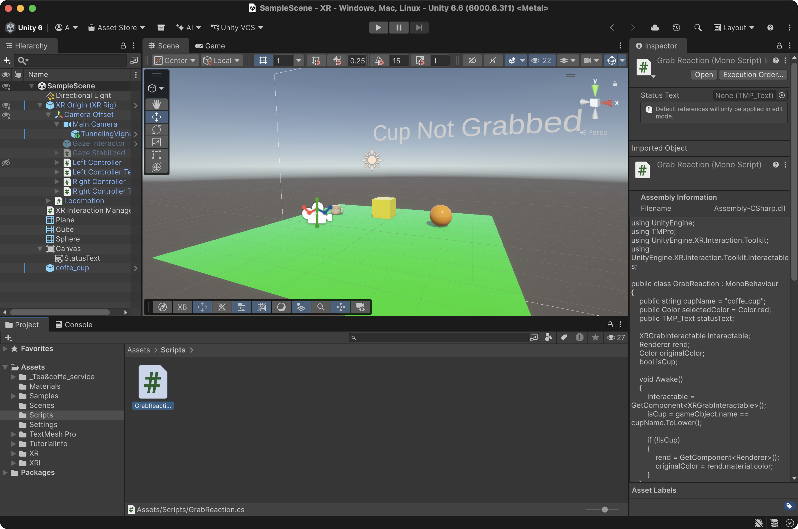

# Práctica 6 - XR Interaction Toolkit

Asignatura: Interfaces Inteligentes  
Universidad: Universidad de La Laguna  
Titulación: Grado en Ingeniería Informática  
Curso: 2026/2027  
Fecha: 6 de noviembre de 2026

Proyecto de Unity con el **XR Interaction Toolkit** en el que el jugador interactúa con tres objetos colocados sobre un plano a distintas distancias:

- Un **cubo** y una **esfera**, que se agarran con **Ray Interactor** (desde lejos) y **cambian de color** al seleccionarlos.
- Un **objeto de la Asset Store** (una taza), que se agarra con **Direct Interactor** (por contacto) y **actualiza un texto de la UI** al agarrarlo y soltarlo.

## 1. Entorno

| Elemento | Versión / detalle |
|---|---|
| Unity | 6.6 (6000.6.3f1) |
| Paquetes XR | XR Plugin Management, OpenXR Plugin, XR Interaction Toolkit (con Starter Assets importados) |
| Simulación | **XR Device Simulator** del XR Interaction Toolkit |

## 2. Configuración inicial

1. Instalación de **XR Plugin Management**, **OpenXR Plugin** y **XR Interaction Toolkit**.
2. Importación de **Samples → Starter Assets** para disponer de prefabs ya configurados (XR Origin, mandos, interactores).
3. Activación de **OpenXR** en *XR Plugin Management* (pestaña Standalone) y marcado de los perfiles de interacción (Oculus Touch Controller Profile, etc.).
4. Uso del **XR Device Simulator** para probar en Play Mode sin gafas.

## 3. Estructura de la escena

- **Eliminada la Main Camera**: el XR Origin trae su propia cámara y dos cámaras en escena pueden provocar problemas de vista.
- **XR Origin (XR Rig)** de los Starter Assets: define el suelo, la cámara (cabeza) y los dos mandos con sus interactores.
- **XR Interaction Manager** y **XR Device Simulator** en la escena.
- **Plano** como suelo.
- **Cubo**, **esfera** y **taza** colocados a diferentes distancias del jugador.
- **Canvas** con un texto (`StatusText`) que muestra el estado de la taza.

## 4. Objetos interactuables

Cada objeto necesita tres componentes:

| Componente | Qué aporta | Si falta |
|---|---|---|
| Collider | Permite que los interactores lo detecten | No es detectado |
| Rigidbody | Física: cae, rebota, se puede lanzar | No responde a la física al soltarlo |
| XR Grab Interactable | Lo marca como agarrable y define su comportamiento | No se puede agarrar |
